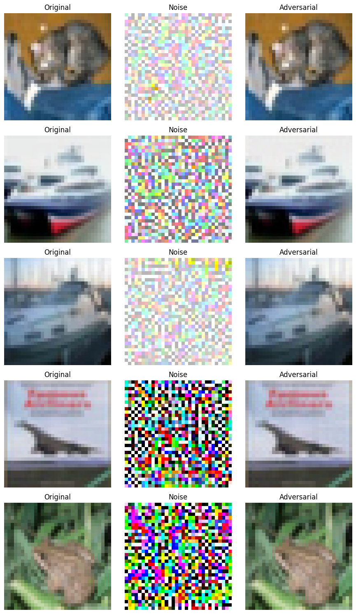
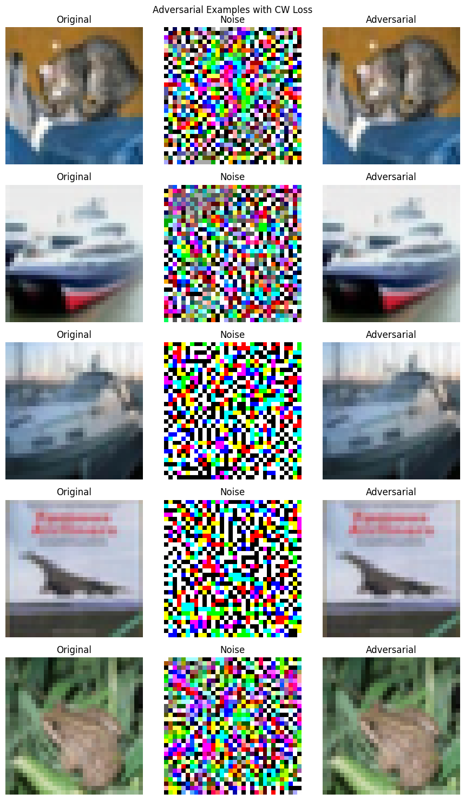
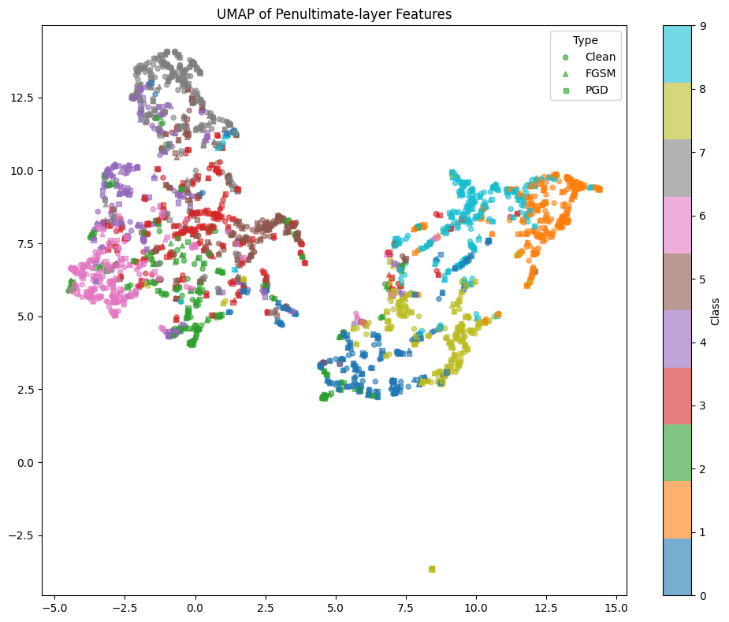
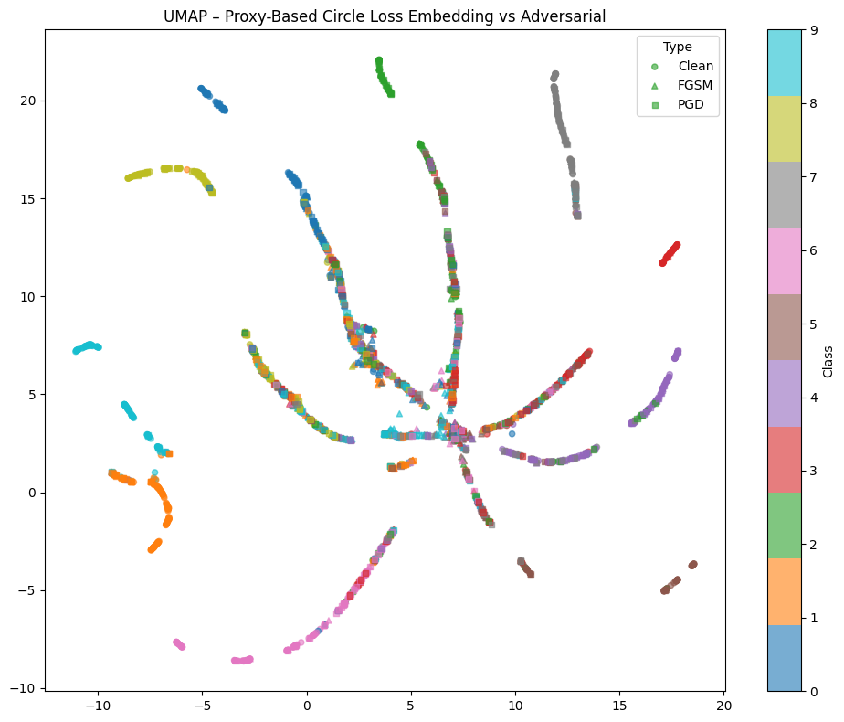
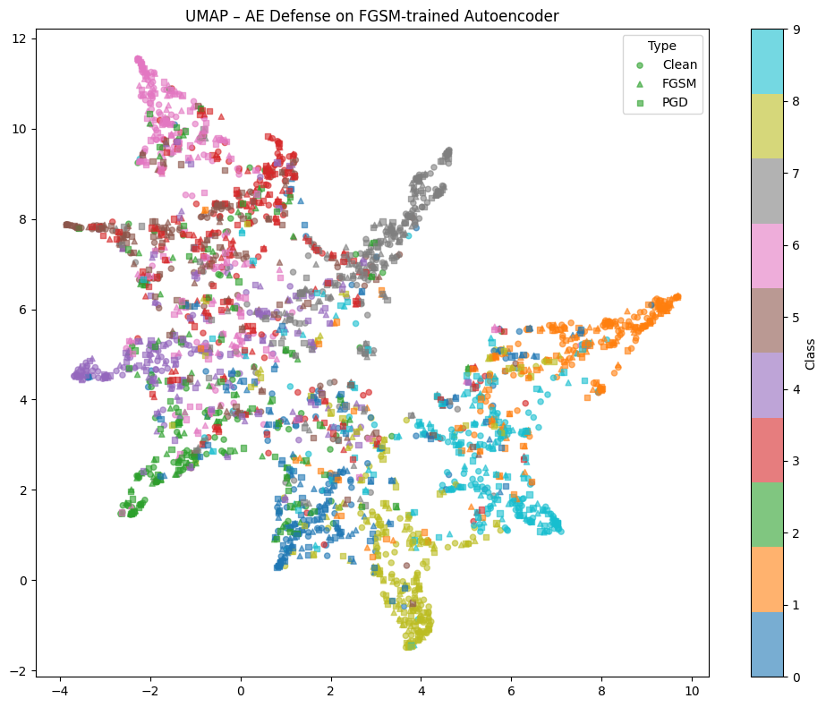

# Adversarial attacks and defences on CIFAR-10

Four L-infinity attacks and four defences, run against one pretrained
ResNet-20 on CIFAR-10. The headline result is that of the four defences only
adversarial training produces robustness that survives being attacked
properly: it holds 62.67% under PGD where the undefended model holds 7.08%.
The other three — data augmentation, metric learning with Circle Loss, and a
denoising autoencoder as a preprocessor — either barely move the needle or
look much better than they are because of how they were measured.

The second result is methodological, and it is the reason this repository
exists in the form it does. The original coursework measured its four
strongest-looking defences with attacks that were silently broken: the attack
library assumed images in `[0, 1]`, it was handed normalised tensors ranging
about −2.4 to 2.7, and it clamped them. One of those defences reported higher
accuracy *under attack* than on clean data, which is the classic signature of
a broken evaluation rather than a good defence. That number is still in the
table below, marked, because the interesting thing about it is not the number
but how you tell.

Everything here works on images in `[0, 1]`, with normalisation moved inside
the model wrapper, so `eps = 8/255` means eight levels of an 8-bit pixel in
every notebook.

<p align="center">
  <br>
  <em>PGD at &epsilon;=0.03 against the pretrained ResNet-20: original,
  perturbation (rescaled for display), adversarial.</em>
</p>

## Notebooks

| notebook | what it does |
|---|---|
| [`01_attacks.ipynb`](notebooks/01_attacks.ipynb) | FGSM, PGD, MI-FGSM (momentum PGD) and Auto-PGD with both the cross-entropy and the Carlini-Wagner objective, at a shared budget, with example grids and a comparison table |
| [`02_training_defences.ipynb`](notebooks/02_training_defences.ipynb) | data augmentation and adversarial training, each evaluated clean / FGSM / PGD with a UMAP of the penultimate space |
| [`03_metric_learning.ipynb`](notebooks/03_metric_learning.ipynb) | pair-based Circle Loss and proxy Circle Loss as robustness regularisers |
| [`04_autoencoder_defence.ipynb`](notebooks/04_autoencoder_defence.ipynb) | a denoising autoencoder trained on adversarial and on Gaussian-noise corruptions, evaluated both end-to-end and against a transferred attack |

[`advlab.py`](advlab.py) holds everything the notebooks share: the model
wrapper, the data loaders, the four attacks, and the plotting.
[`docs/report.md`](docs/report.md) is an English translation of the report
submitted with the original coursework, annotated where it disagrees with its
own code.

## Model and data

| | |
|---|---|
| dataset | CIFAR-10, 50,000 train / 10,000 test, 32×32 RGB |
| model | ResNet-20 from [`chenyaofo/pytorch-cifar-models`](https://github.com/chenyaofo/pytorch-cifar-models), 0.27M parameters |
| clean accuracy | 92.59% on the test set |
| attack norm | L-infinity, `eps = 8/255` unless stated |
| feature space | the 64-d input of the final linear layer |

## The attacks

All four are implemented in [`advlab.py`](advlab.py) and all four take and
return images in `[0, 1]`, guaranteeing `||x_adv - x||_inf <= eps` and
`x_adv in [0, 1]` for the `eps` they were given.

| attack | accuracy after attack | drop |
|---|---|---|
| none | 92.59% | — |
| FGSM | 15.18% | 77.41 |
| PGD, 10 steps | 7.08% | 85.51 |
| MI-FGSM (momentum PGD) | 4.72% | 87.87 |
| Auto-PGD, CE objective | 2.54% | 90.05 |
| Auto-PGD, CW objective | 2.98% | 89.61 |

The ordering is the expected one: one step is weaker than ten, momentum makes
ten steps go further, and an adaptive step size that restarts from the best
point found goes furthest. The CW objective lands marginally behind CE here;
on a defended model it usually leads, because a margin objective keeps pushing
after cross-entropy has saturated.

<p align="center">
  <br>
  <em>Auto-PGD with the Carlini-Wagner margin objective.</em>
</p>

## The defences

| defence | clean | FGSM | PGD | |
|---|---|---|---|---|
| none (baseline) | 92.59% | 15.18% | 7.08% | |
| data augmentation | 79.00% | 32.11% | 18.67% | trained from scratch, not fine-tuned — see below |
| **adversarial training** | **86.82%** | **66.17%** | **62.67%** | 3 epochs, half the training set |
| Circle Loss (pair-based) | 90.05% | 33.57% | 6.64% | ⚠ broken attack |
| Circle Loss (proxy-based) | 90.25% | 47.45% | 41.38% | ⚠ broken attack |
| autoencoder, adversarial corruption | 45.29% | **50.83%** | 25.58% | ⚠ broken attack; FGSM > clean |
| autoencoder, Gaussian corruption | 52.85% | 48.00% | 21.29% | ⚠ broken attack |

These are the **original run's** numbers, reproduced here so that the report
and the corrections have something concrete to refer to. The corrected
notebooks in this repository will not reproduce the four ⚠ rows: those were
measured against an attack that did not work, and a working attack will give
worse numbers. See [what was corrected](#what-was-corrected). The notebooks
need a GPU and a few hours to re-run, so nothing here has been re-measured.

### Comparability of the budgets

Not all of the rows above share an epsilon, and this is worth being explicit
about because the original report's comparison table presented them as though
they did.

- **The four PGD-family attacks** applied `eps = 0.03` in *normalised* space,
  which with the std in use is about `0.006` in pixels — roughly `1.5/255`.
- **The FGSM row in Part 1** applied `0.03` in *pixel* space, `7.65/255`. That
  is about five times the budget of the rows it was tabulated against.
- **The four ⚠ rows** used `8/255` from `torchattacks`, applied to normalised
  tensors that the library then clamped to `[0, 1]`. Comparable to nothing.

The five-times mismatch does not overturn the report's conclusion that PGD
beats FGSM; it strengthens it. PGD reached 7.08% on a fifth of the budget FGSM
needed for 15.18%. But the table was not measuring what it said it was
measuring, and at a common `8/255` the gap is wider than it shows.

### Adversarial training

The one defence that trains on what it defends against, and the only one whose
robustness holds up. Each batch contributes three cross-entropy terms — clean,
FGSM and PGD — averaged. Three epochs on half the training set moved PGD
accuracy from 7.08% to 62.67% at a cost of 5.8 points of clean accuracy.

<p align="center">
  <br>
  <em>UMAP of the penultimate features. Circles clean, triangles FGSM, squares
  PGD; colour is the class. Clean and adversarial points for the same class now
  sit on top of one another, which is what robustness looks like in this
  space.</em>
</p>

Two ordering hazards make this cell easy to get wrong, and the original got
both. The attacks have to be generated in `eval()` mode, or ten PGD forward
passes per batch drag the BatchNorm running statistics towards the adversarial
distribution. And `opt.zero_grad()` has to come *after* the attacks, because
each attack's `backward()` deposits gradients on the parameters too — zeroing
first means the update also contains ten steps' worth of attack gradient.

### Data augmentation

Random crops, flips, colour jitter and rotation, then fine-tuning. It buys
about 11 points of PGD robustness over the baseline and costs 13 points of
clean accuracy, which is not a good trade.

That it helps at all is slightly surprising and worth being careful about: the
79.00% figure comes from a model trained **from scratch for 10 epochs**, not
fine-tuned from the pretrained checkpoint, so it is undertrained rather than
augmentation-damaged. Its higher attacked accuracy is partly the flatter
gradients of an undertrained network, not robustness. The corrected notebook
fine-tunes from `pretrained=True` so that the comparison is against the
baseline it claims to be against.

The reason augmentation cannot do much here is that its invariances are the
wrong ones. A random crop teaches the model that a cat shifted four pixels is
still a cat. An adversarial perturbation is not a shift — it is a specific
direction in a 3072-dimensional space chosen because the model is steep along
it, and no amount of cropping tells the model anything about that direction.

### Circle Loss

<p align="center">
  <br>
  <em>Proxy Circle Loss. The clean clusters are compact and well separated;
  the adversarial points have left them.</em>
</p>

Two variants: pair-based `CircleLoss(m=0.25, gamma=256)` on a 64-d embedding
for 40 epochs followed by a fresh linear head, and a proxy variant learning
one vector per class and treating scaled cosine similarity as logits. The
proxy variant reported six times the PGD accuracy of the pair-based one
(41.38% against 6.64%), which sounds like a real finding and probably is not —
both were measured with the broken attack, and the proxy head's cosine
normalisation changes the loss surface in exactly the way that makes a clamped
attack less effective.

The structural point stands regardless of the measurement. Circle Loss
optimises distances between *clean* embeddings. Nothing in the objective
requires the embedding to vary slowly inside an epsilon ball, so nothing in it
is a defence. It is a regulariser to combine with adversarial training, not an
alternative to it.

### Autoencoder as a preprocessor

<p align="center">
  <br>
  <em>The autoencoder defence. Clean and adversarial clusters have not
  converged, which is the honest reading of a defence that reported 50.83%
  under FGSM.</em>
</p>

A convolutional autoencoder trained to map corrupted images back to clean
ones, placed in front of the classifier, with the classifier's head fine-tuned
on reconstructions. Two corruptions were tried: PGD adversarial examples and
`N(0, 0.1)` Gaussian noise. Neither works, and the two failure modes are
instructive.

**The reconstruction objective cannot see the perturbation.** An `8/255`
L-infinity perturbation contributes at most `(8/255)^2` ≈ `1e-3` to the MSE.
The autoencoder's own clean reconstruction error is an order of magnitude
larger than that. Asking MSE to remove the perturbation is asking it to
optimise a term it cannot distinguish from its own noise floor.

**The reported robustness came from a transferred attack.** In the original,
the attack was generated against the bare classifier and then fed through the
autoencoder, so the gradient the attacker used was not the gradient of the
deployed system. That is why FGSM accuracy (50.83%) came out *above* clean
accuracy (45.29%) — a physically impossible result for a working defence,
since FGSM at `eps = 0` is the clean case. This is gradient masking (Athalye
et al., 2018): the defence did not make the model robust, it made the gradient
uninformative.

Notebook 4 therefore reports **both** numbers: end-to-end, where the attack
differentiates through the autoencoder, and transferred, where it does not.
The gap between them is the size of the illusion.

There was also a plumbing bug worth naming because it is easy to make. The
decoder ends in `nn.Sigmoid()`, so its output lives in `[0, 1]`, while the MSE
target was a *normalised* image ranging about −2.4 to 2.7. Roughly half of
every target value is negative by construction and therefore unreachable. The
MSE curve plateaus at about 0.925 from epoch 6 onwards; that plateau is the
output range of the activation, not the capacity of the model.

## What was corrected

The original was a single 23-cell notebook. Fixing it meant separating three
different kinds of problem: results that are wrong, results that are right but
not comparable, and code that works but should not be copied. Everything in
the first two groups is documented rather than quietly changed, so the numbers
in the tables above stay traceable to the run that produced them.

**Attacks measured in the wrong space**

1. `torchattacks`' `FGSM` and `PGD` were applied to **normalised** tensors.
   Both classes assume input in `[0, 1]` and clamp to it internally, so every
   negative value in a normalised image — about half of them, since
   normalisation subtracts the channel mean — was crushed to zero before the
   attack started. All four metric-learning and autoencoder robustness numbers
   were measured against this. `torchattacks` is deliberately absent from
   [`requirements.txt`](requirements.txt); the attacks are implemented here
   instead, all on `[0, 1]` input.
2. Epsilon was applied in normalised space in the PGD, momentum-PGD and
   Auto-PGD cells, making the effective pixel budget about `1.5/255` while the
   FGSM cell used `7.65/255` and the later cells used `8/255`. Normalisation
   now lives inside the model (`advlab.Normalised`), so a single `eps` on
   `[0, 1]` input means the same thing everywhere.
3. `eps = 0.03` in the first half of the notebook against `8/255 = 0.0314` in
   the second — close, unequal, and undocumented.
4. The CIFAR-10 std was `(0.2023, 0.1994, 0.2010)`, a widely-copied value from
   an old Torch7 recipe that is the std of per-image-normalised data, not of
   the raw images. The true values are `(0.2470, 0.2435, 0.2616)`, and they are
   what the pretrained weights were trained with. Every valid-range bound
   derived from the wrong std was consequently wrong too.

**Attacks that were not the attack they were named**

5. "PGD with momentum" accumulated `grad.sign()`. MI-FGSM (Dong et al., 2018)
   divides the gradient by its own L1 norm before accumulating, which is what
   makes `mu` meaningful across steps whose gradients differ in scale.
   Accumulating signs leaves decay as the only thing momentum does.
6. "AutoPGD" was plain fixed-step PGD run for 20 iterations. Auto-PGD (Croce &
   Hein, 2020) is defined by three things the original had none of: a step size
   starting at `2*eps` and halved at a computed checkpoint schedule, momentum
   over the previous iterate, and restarting from the best point found on each
   halving. [`advlab.apgd`](advlab.py) implements all three.
7. The CW objective used `torch.max((1 - onehot) * logits)`, which selects the
   zeroed true-class slot whenever every other logit is negative — returning 0
   instead of the real runner-up. Masking with `-inf` fixes it.
8. The PGD cell never clamped the adversarial image to the valid range at all.
9. The FGSM cell's clamp was dead arithmetic:
   `clamp(delta, low - imgs*0 + 0, high - imgs*0 + 0)` reduces to
   `clamp(delta, low, high)`. The intent was `low - imgs` / `high - imgs`.
   Separately, channel 0's bounds were used for all three channels.

**A defence evaluated against the wrong model**

10. The autoencoder defence's attacks were generated against the **bare
    classifier** and then passed through the autoencoder, so the reported
    robustness was against a transferred attack, not the deployed system. This
    is what produced FGSM accuracy above clean accuracy. Notebook 4 reports
    both end-to-end and transferred numbers.
11. In the Gaussian-noise cell the classifier had `model.fc = nn.Identity()`
    and was then used as a classifier: `CrossEntropyLoss` was computed over the
    64-d feature vector as if it were 64 class logits, and `argmax(1)` was a
    64-way decision compared against labels `0-9`. Every accuracy that cell
    reported is invalid.
12. In the adversarial-corruption cell the model used to *generate* the
    training attacks also had `fc = nn.Identity()`, so the "adversarial" data
    the autoencoder learned to clean maximised cross-entropy against ten of 64
    arbitrary feature dimensions. It was not adversarial to anything.
13. The decoder's `nn.Sigmoid()` output was regressed onto normalised targets,
    making half of every target unreachable — see above. Both the autoencoder's
    input and its target are now images in `[0, 1]`.
14. The Gaussian-noise cell clamped normalised images to `[0, 1]` before adding
    noise, corrupting both the input and the target.

**Training-loop bugs**

15. Attack generation leaked gradients into the parameter update:
    `opt.zero_grad()` ran before the attacks, so the accumulated attack
    gradients were still on the parameters when `opt.step()` was called.
16. Attacks were generated with the model in `train()` mode, so every PGD step
    updated the BatchNorm running statistics towards the adversarial
    distribution.
17. The data-augmentation cell used `pretrained=False` while every other cell
    used `pretrained=True`, and the full 50k training set while the others used
    half — so the one model presented as a fine-tuned baseline was neither
    fine-tuned nor comparably trained.
18. `steps=5` for PGD in the last cell against `steps=10` everywhere else,
    undocumented.
19. Seeding was inconsistent across four cells: one `random.shuffle` unseeded,
    one `random_split` unseeded, two with `generator=torch.Generator()
    .manual_seed(42)`, and one both unseeded and using an unseeded
    `np.random.choice`. There is now one `advlab.set_seed()` called at the top
    of every notebook, and `cifar10(fraction=...)` takes a deterministic
    subset.
20. `torch.autograd.set_detect_anomaly(True)` was left enabled for a whole
    cell, together with a `for m in model.modules(): m.inplace = False`
    workaround for the problem it was diagnosing.

**Plotting and reporting**

21. Class indices were never mapped to names, so every figure was labelled
    `0`-`9`. `advlab.CLASSES` is used throughout, and `show_attack_grid` marks
    each panel with the predicted class name in red when it is wrong.
22. The misclassified-samples cell used `mask.nonzero().squeeze()`, which
    yields a 0-d tensor when exactly one sample in a batch is misclassified and
    raises `TypeError` on iteration.
23. That cell's `break` exited only the inner loop, so it *printed* 15 entries
    while the figure correctly showed a 3×3 grid of 9 — and no panel carried
    its true or predicted label.
24. One loss figure put a 40-epoch series and a 10-epoch series on a shared
    axis, in different units. They are now two panels.
25. One training stage recorded no loss history at all.
26. `plt.savefig` without `plt.show()`, so the figure was written but never
    displayed in the notebook.
27. Persian `print` statements in an otherwise English notebook.

**Structure and performance**

28. `_clamp`, `clamp_norm` and `clamp_tensor` were three names for the same
    function; `AttackEvaluator` was duplicated verbatim in two cells; every
    cell re-imported torch, re-downloaded CIFAR-10 and re-defined the
    normalisation constants. All of it is now in
    [`advlab.py`](advlab.py).
29. `if __name__ == "__main__":` guards inside notebook cells.
30. Tensors were round-tripped CPU → GPU → CPU three times per batch in the
    evaluation loop.
31. One feature-extraction helper mutated `model.fc` to `nn.Identity()` and
    back on every batch. `advlab.Penultimate` uses a forward pre-hook instead,
    and notebook 3 uses a context manager for the one case that genuinely
    needs the head swapped.
32. A clean forward pass ran without `torch.no_grad()`, building a graph that
    was immediately discarded.
33. Unused imports and bindings: `from torchattacks import FGSM, PGD` in two
    cells that never called them, plus unused `Subset`, `random` and `bsz`.

## Where the report and the code disagree

[`docs/report.md`](docs/report.md) is the submitted report, translated. Four
places where it describes something other than what the code does, and two
things it leaves out, are marked in it with notes. Summarised:

| the report says | the code does |
|---|---|
| the augmentation model is fine-tuned from the pretrained baseline on half the training set | `pretrained=False`, from scratch, 10 epochs, full 50k set — so its explanation of the accuracy drop is wrong about its own cause |
| the correct MI-FGSM update, with L1 normalisation | accumulates `grad.sign()` |
| the real Auto-PGD, with phases, adaptive step size, momentum and checkpoints | fixed-step PGD, 20 iterations |
| autoencoder accuracies of 44.61 / 42.53 / 25.26 | the submitted notebook shows 45.29 / 50.83 / 25.58 — a different run, and only the notebook's shows the impossible FGSM > clean inversion |

And two omissions: the report gives one Circle Loss result set, labelled
*proxy*, so the plain pair-based numbers (90.05 / 33.57 / 6.64) appear nowhere
— which hides the most interesting comparison in that section; and the
Gaussian-noise autoencoder is never mentioned at all, although its results are
close enough to the adversarial one's to suggest the reconstruction objective
is what limits both.

## Running it

```bash
pip install -r requirements.txt
jupyter lab notebooks/
```

Run the notebooks in order; each is self-contained past `advlab`. A CUDA GPU is
effectively required — notebook 2's adversarial training generates ten PGD
steps per batch, and notebook 3 trains an embedding for 40 epochs.

CIFAR-10 downloads itself on first use, into `data/` next to the notebooks. To
point that somewhere else — a shared cache, or a drive with more room — set
`CIFAR10_DATA_DIR` before starting Jupyter. It is read in
[`advlab.py`](advlab.py) via `os.environ` and is the only environment variable
this repository uses; there is no `.env` file to fill in.

PowerShell:

```powershell
$env:CIFAR10_DATA_DIR = "D:\datasets\cifar10"
jupyter lab notebooks/
```

bash:

```bash
export CIFAR10_DATA_DIR=~/datasets/cifar10
jupyter lab notebooks/
```

The pretrained ResNet-20 is fetched through `torch.hub` on first call and
cached under `~/.cache/torch/hub`.

## References

- Goodfellow, Shlens & Szegedy (2015). *Explaining and Harnessing Adversarial
  Examples.* ICLR.
- Madry, Makelov, Schmidt, Tsipras & Vladu (2018). *Towards Deep Learning
  Models Resistant to Adversarial Attacks.* ICLR.
- Dong, Liao, Pang, Su, Zhu, Hu & Li (2018). *Boosting Adversarial Attacks with
  Momentum.* CVPR.
- Croce & Hein (2020). *Reliable Evaluation of Adversarial Robustness with an
  Ensemble of Diverse Parameter-free Attacks.* ICML.
- Carlini & Wagner (2017). *Towards Evaluating the Robustness of Neural
  Networks.* IEEE S&P.
- Athalye, Carlini & Wagner (2018). *Obfuscated Gradients Give a False Sense of
  Security.* ICML.
- Sun, Cheng, Zhang, Zhang, Zheng, Wang & Wei (2020). *Circle Loss: A Unified
  Perspective of Pair Similarity Optimization.* CVPR.

## Licence

[MIT](LICENSE).

## Contributors

- Alireza Shiri (@AlirezaShG)
